<div align="center">


<h1>Sticko</h1>

<p>Custom WhatsApp sticker maker for Android, built with Flutter and a native Kotlin bridge.</p>

<p>
  <a href="https://github.com/vikri546/sticko/releases/latest"></a>
  <a href="https://github.com/vikri546/sticko/releases"></a>
  <a href="https://www.android.com"></a>
  <a href="https://flutter.dev"></a>
  <a href="https://dart.dev">= 3.11.0" /></a>
  <a href="https://kotlinlang.org"></a>
</p>

<p>
  <a href="#download">Download</a> &middot;
  <a href="#features">Features</a> &middot;
  <a href="#preview">Preview</a> &middot;
  <a href="#tech-stack">Tech Stack</a> &middot;
  <a href="#getting-started">Getting Started</a> &middot;
  <a href="#project-structure">Structure</a> &middot;
  <a href="https://github.com/vikri546/sticko/issues">Issues</a>
</p>

</div>

---

## Download

Download the latest APK directly from [GitHub Releases](https://github.com/vikri546/sticko/releases/latest) or inspect release metadata in [`version.json`](version.json).

## Features

- **Static & Animated Stickers:** Converts images, GIFs, and videos (up to 10s) into compliant 512x512 WebP assets following the [WhatsApp Stickers Protocol](https://github.com/WhatsApp/stickers).
- **Sticker Studio & Ordering:** Canvas controls for framing, rotation, mirroring, zoom, meme text, and drag-and-drop pack sorting.
- **Multi-Client WhatsApp Export:** Native Android chooser via [`StickerContentProvider`](android/app/src/main/kotlin/com/pkri/sticko/StickerContentProvider.kt) supporting WhatsApp, WhatsApp Business, Dual Apps, and cloned clients.
- **Backup & Maintenance:** Cross-pack duplicate detection, local ZIP archive backup/restore, and cache cleanup.
- **OTA App Updates:** Automated version checks, changelog previews, and status-bar APK downloads powered by [GitHub Releases](https://github.com/vikri546/sticko/releases).

## Preview

### Sticker Creation & Pack Studio

| Explore | Pack Workspace | Batch WebP Import (30x) | Pack Ready (30/30) |
| :---: | :---: | :---: | :---: |
| 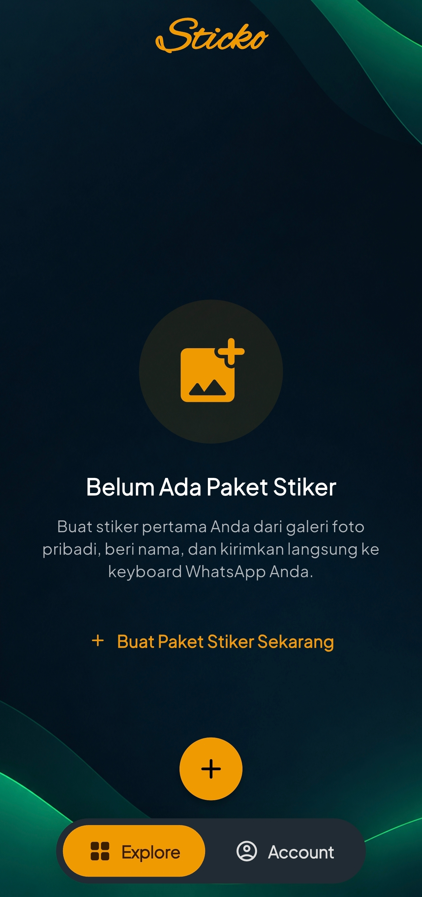 | 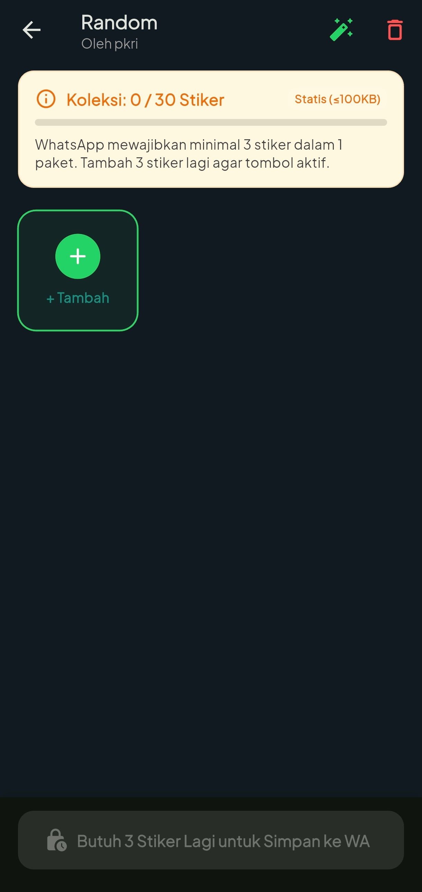 | 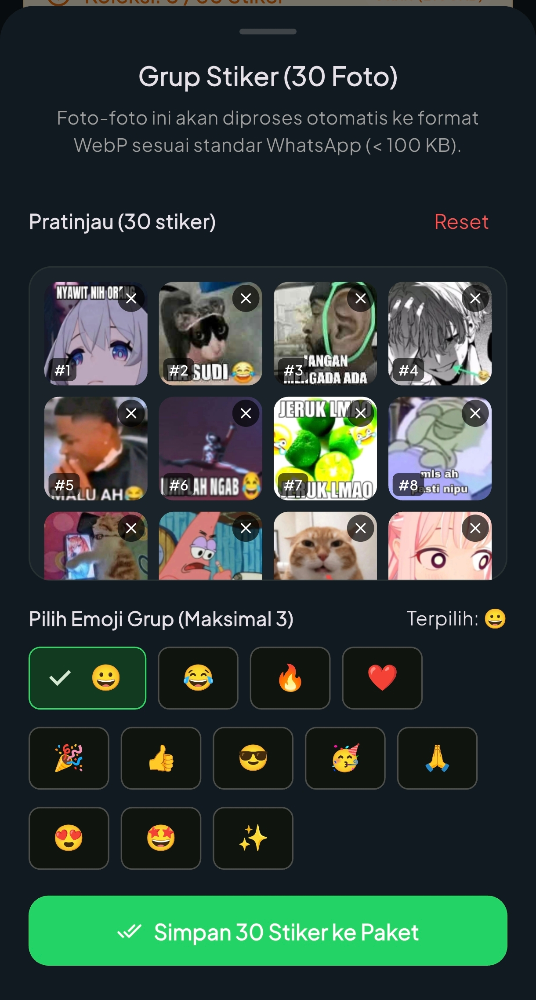 | 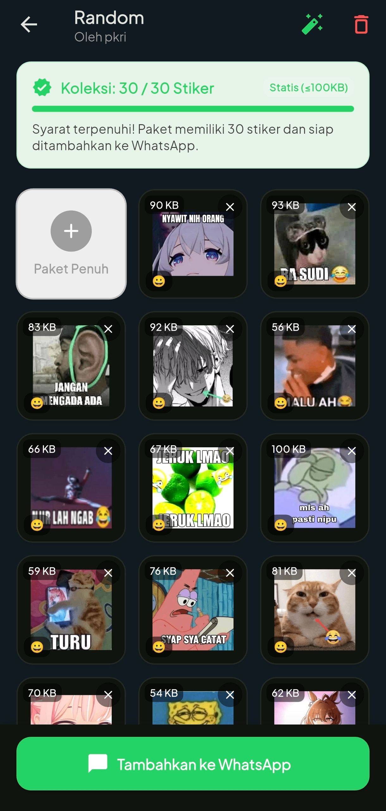 |

| Create Pack Dialog | Media Source Picker | Export Confirmation |
| :---: | :---: | :---: |
| 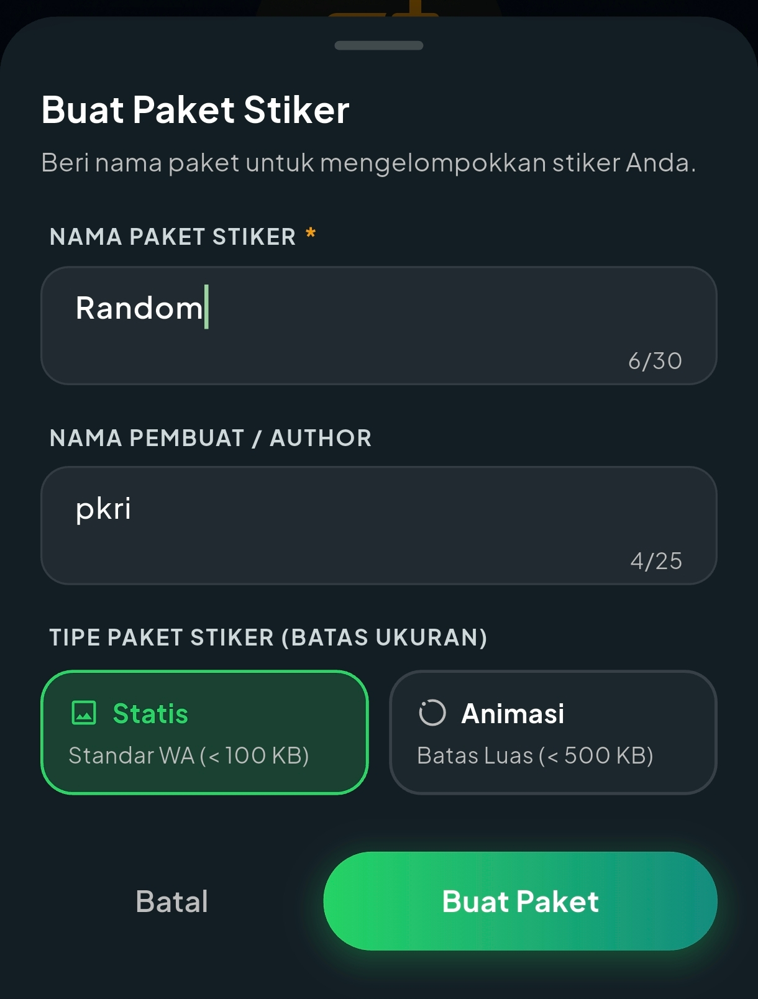 | 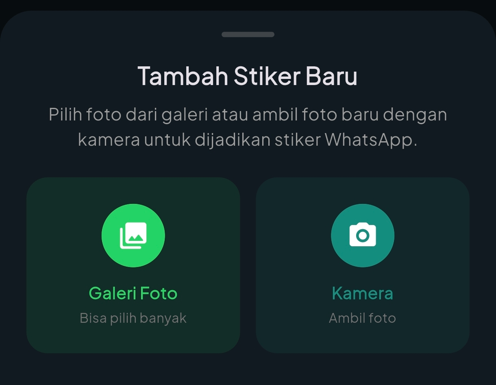 |  |

### Multi-Client Export & WhatsApp Integration

| WhatsApp & Business Chooser | Original & Dual App Chooser | Shared Pack Card |
| :---: | :---: | :---: |
| 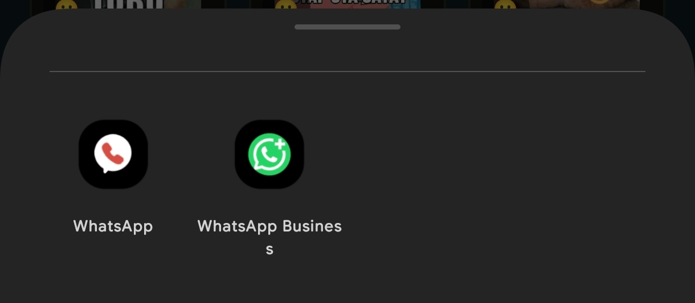 | 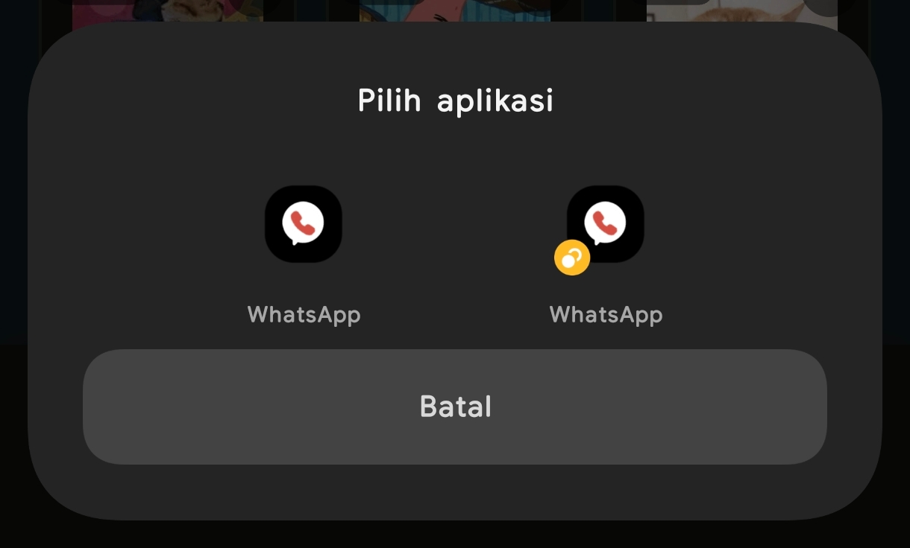 | 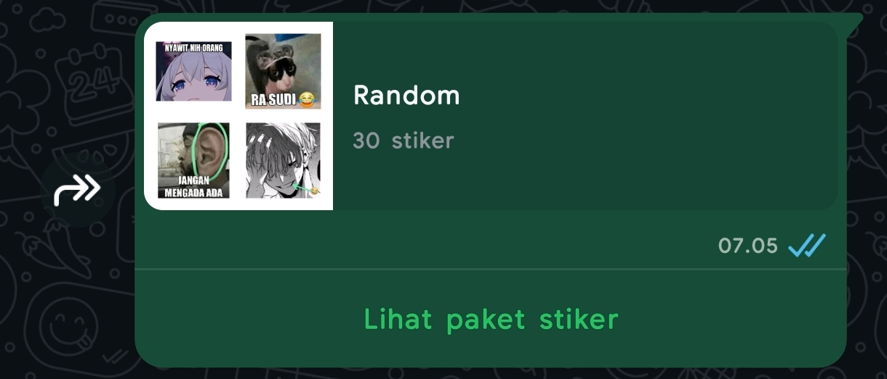 |

| WhatsApp Import Prompt | Sticker Keyboard Tray | Stickers in Chat |
| :---: | :---: | :---: |
| 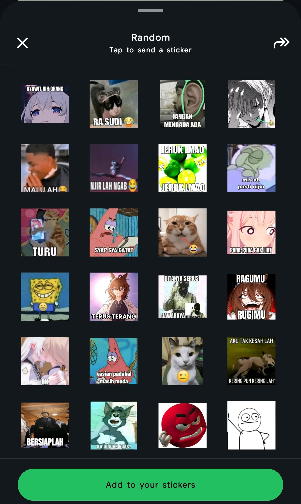 | 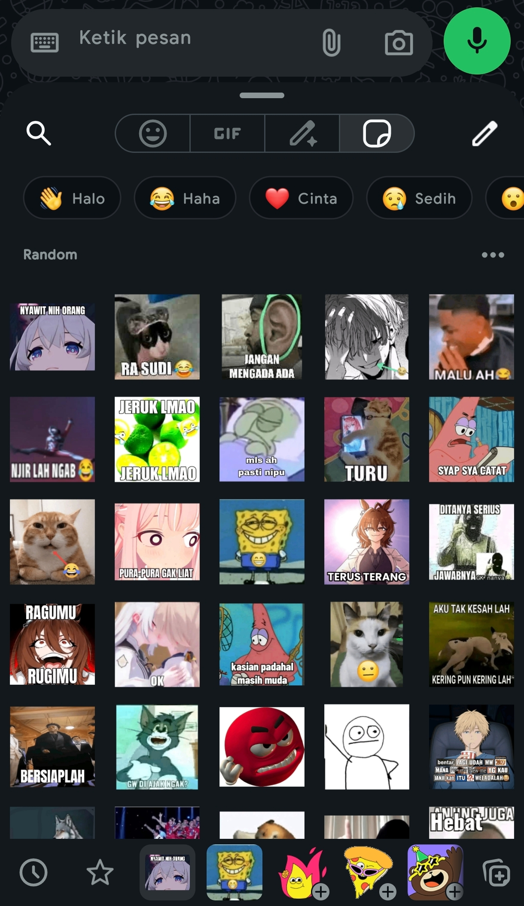 | 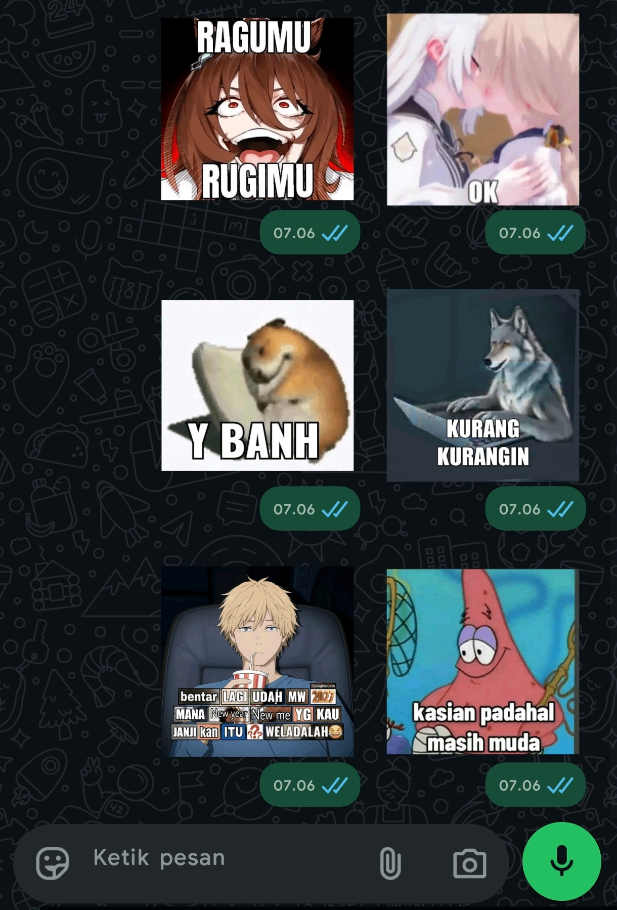 |

### Account, Releases & Utilities

| Creator Collection | Account Overview | Utilities & Social Links |
| :---: | :---: | :---: |
| 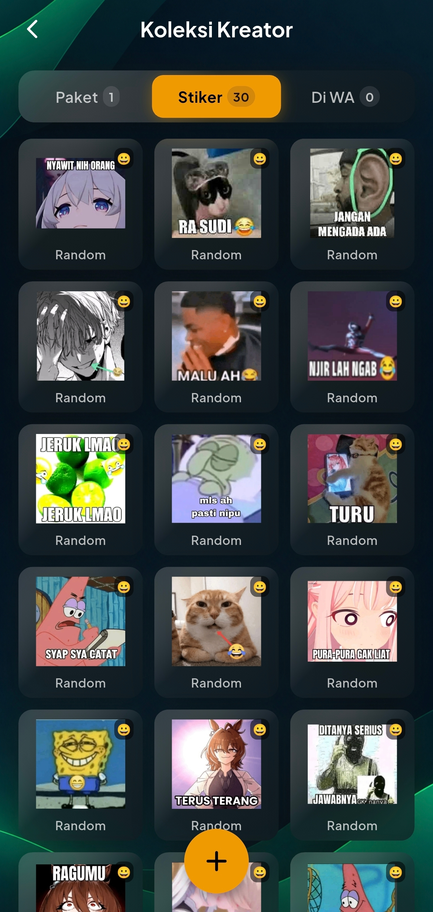 | 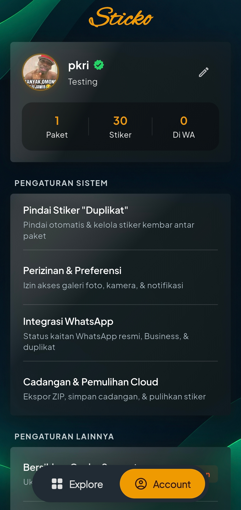 | 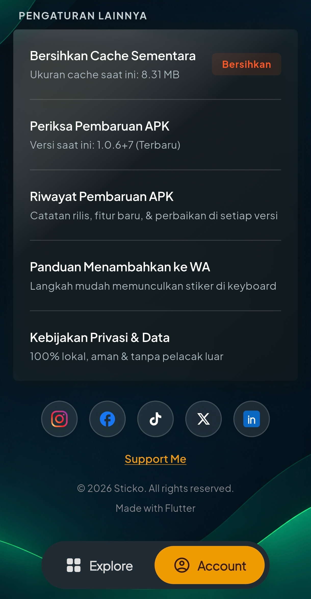 |

| Edit Creator Profile | APK Update History | Cloud & ZIP Backup |
| :---: | :---: | :---: |
| 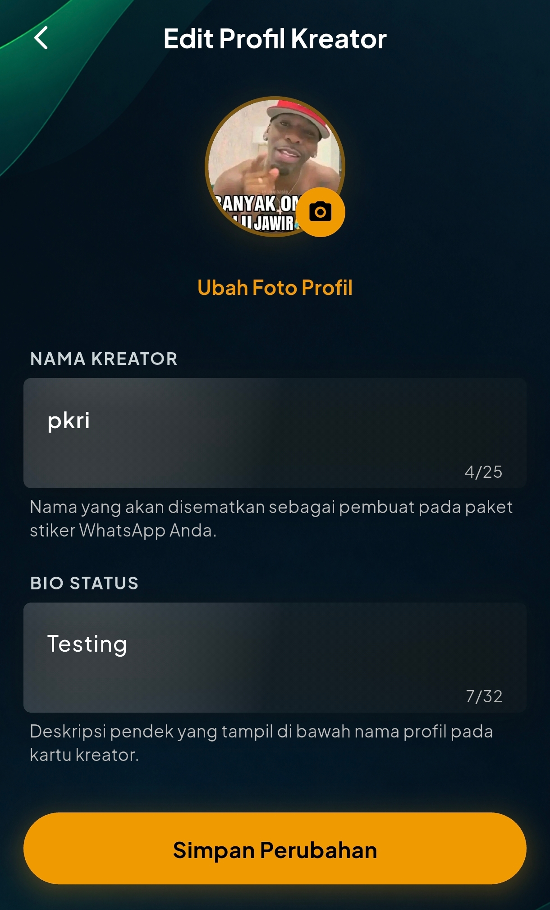 | 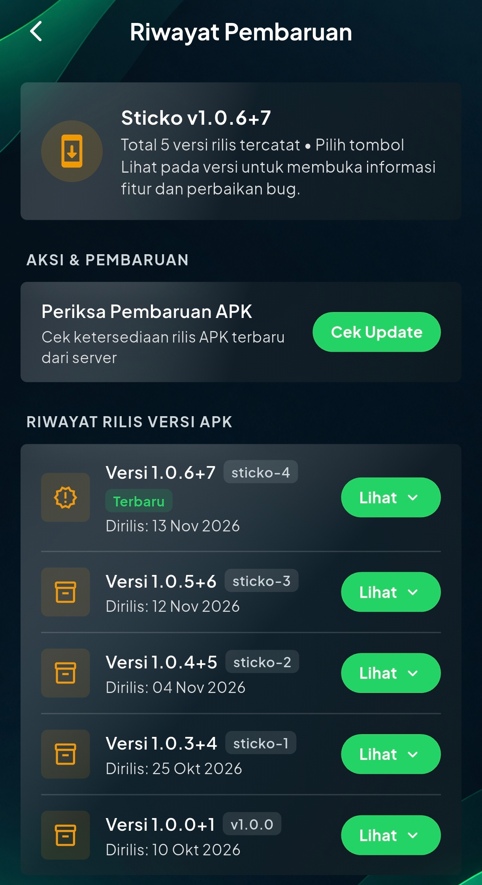 | 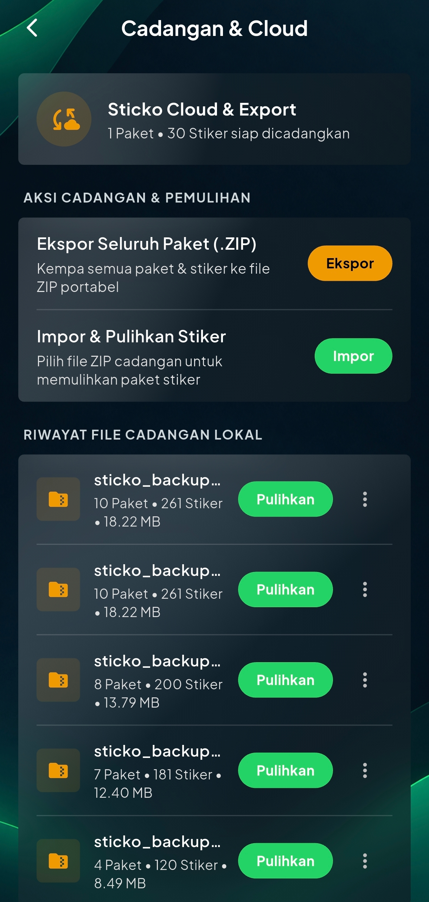 |

## Tech Stack

| Layer | Technology |
| --- | --- |
| Framework | [Flutter](https://flutter.dev) ([Dart](https://dart.dev) `>=3.11.0`) |
| Native Android | [Kotlin](https://kotlinlang.org) (`MethodChannel`, [`MainActivity`](android/app/src/main/kotlin/com/pkri/sticko/MainActivity.kt), [`StickerContentProvider`](android/app/src/main/kotlin/com/pkri/sticko/StickerContentProvider.kt)) |
| Media & Archives | [`image`](https://pub.dev/packages/image), [`image_picker`](https://pub.dev/packages/image_picker), [`file_picker`](https://pub.dev/packages/file_picker), [`archive`](https://pub.dev/packages/archive) |
| Utilities | [`permission_handler`](https://pub.dev/packages/permission_handler), [`open_filex`](https://pub.dev/packages/open_filex), [`url_launcher`](https://pub.dev/packages/url_launcher), [`crypto`](https://pub.dev/packages/crypto) |

## Getting Started

### Prerequisites

- [Flutter SDK](https://docs.flutter.dev/get-started/install) (Dart `>=3.11.0`)
- [Android SDK](https://developer.android.com/studio) (`compileSdk 37`) and Java 17

### Setup

```bash
git clone https://github.com/vikri546/sticko.git
cd sticko

# Optional: configure creator social links (ignored by Git)
cp assets/config/social_links.json.example assets/config/social_links.json

flutter pub get
flutter run
```

### Verification & Build

```bash
flutter analyze
flutter test
flutter build apk --release
```

## Project Structure

```text
sticko/
├── android/app/src/main/kotlin/com/pkri/sticko/  # Native Kotlin bridge & ContentProvider
├── assets/config/                                 # Optional creator links template
├── lib/
│   ├── config/                                    # Runtime configuration loaders
│   ├── images/                                    # App icons, backgrounds & showcase assets
│   ├── services/                                  # Pack management, WebP processing, OTA updates
│   └── ui/                                        # Screens and reusable widgets
├── test/                                          # Unit and widget tests
└── version.json                                   # Remote release & changelog manifest
```
